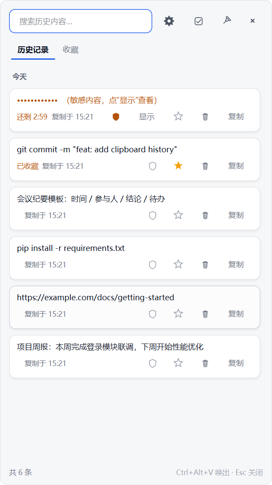
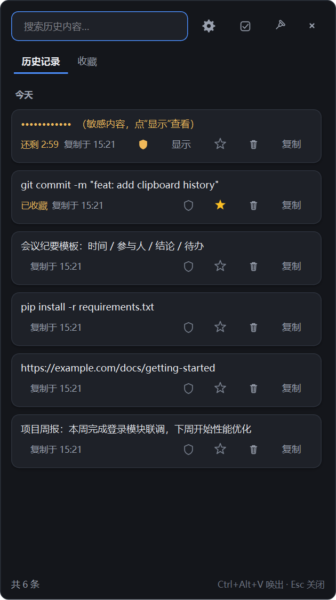
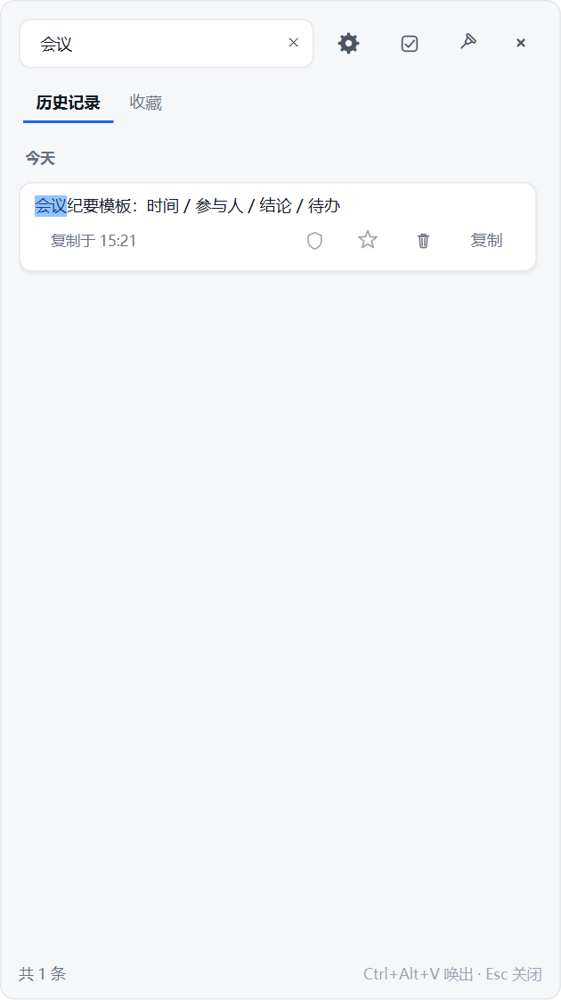
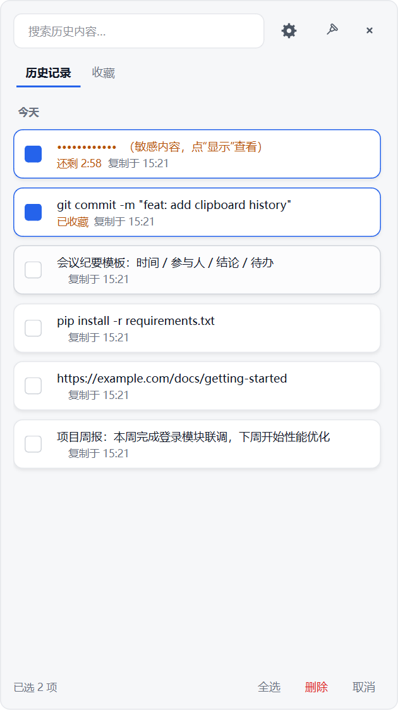

# GluePaw

> 本地加密、隐私优先的剪贴板历史管理器（Windows 优先）

GluePaw 会记录你复制过的文本，按天分组展示，支持搜索、收藏、一键复制和多选删除。
和普通剪贴板工具不同的是：**它默认不信任自己**——敏感内容只在内存中保留几分钟，
普通内容全部加密落库，任何时候都不联网。



## 目录

- [为什么做这个](#为什么做这个)
- [功能](#功能)
- [截图](#截图)
- [快速开始](#快速开始)
- [使用说明](#使用说明)
- [隐私设计](#隐私设计)
- [数据位置](#数据位置)
- [项目结构](#项目结构)
- [测试](#测试)
- [已知限制](#已知限制)
- [路线图](#路线图)
- [参与贡献](#参与贡献)
- [许可证](#许可证)

## 为什么做这个

系统自带剪贴板历史有三个问题：

1. **隐私**：Windows 的 Win+V 云剪贴板会把内容同步到微软账号；密码、验证码也照存不误。
2. **不可控**：没有「这条留几分钟就删」「这条别记」的细粒度选择。
3. **不可搜**：只能翻列表，不能按内容检索。

GluePaw 的目标是：**记录得够用，泄露得够少**。

## 功能

- 实时监听剪贴板，自动按「今天 / 昨天 / 日期」分组
- 顶部搜索框即时过滤，命中关键词在卡片里高亮
- 一键复制、收藏（★）、单条删除（垃圾桶）、多选批量删除
- 每条记录可手动切换「敏感 / 普通」
- **隐私模式**：识别密码、验证码、银行卡号等，只保留在内存中，到点自动删除
- **全局热键** `Ctrl + Alt + V` 随时唤出
- **置顶模式**（图钉）：窗口浮在最上层，但不会盖住确认弹窗
- **明暗主题**：跟随系统，也可在设置里强制浅色 / 深色
- 定期自动清理（1 / 3 / 6 / 12 个月，默认关闭）
- 全程离线，无任何网络请求

## 截图

| 浅色 | 深色 |
| --- | --- |
|  |  |

| 搜索高亮 | 多选删除 |
| --- | --- |
|  |  |

## 快速开始

### Windows（推荐）

```bat
install.bat   :: 把依赖装到项目内的 libs 目录
run.bat       :: 启动，常驻托盘
```

启动后按 `Ctrl + Alt + V` 唤出界面，或双击托盘图标。

### 手动安装

```bash
python -m venv .venv
.venv\Scripts\activate          # macOS/Linux: source .venv/bin/activate
pip install -r requirements.txt
python main.py
```

要求 Python 3.10+，主要依赖：

- [PySide6](https://pypi.org/project/PySide6/) — 界面、托盘、剪贴板
- [cryptography](https://pypi.org/project/cryptography/) — Fernet 加密

## 使用说明

| 操作 | 方式 |
| --- | --- |
| 唤出 / 隐藏 | `Ctrl + Alt + V`，或托盘图标 |
| 复制某条 | 卡片右侧「复制」 |
| 收藏 | 卡片上的星标 |
| 删除单条 | 卡片上的垃圾桶 |
| 批量删除 | 点搜索框右侧的勾选图标 → 选中卡片 → 底部「删除」 |
| 切换敏感标记 | 卡片上的盾牌（实心=敏感，描边=普通） |
| 置顶窗口 | 右上角图钉 |
| 设置 | 右上角齿轮 |
| 退出 | 托盘右键 → 退出 |

多选模式下按 `Esc` 可以退出；窗口重新唤出时也会自动退出多选。

## 隐私设计

这是本项目的核心，完整说明见 [docs/PRIVACY.md](docs/PRIVACY.md)。

| 内容类型 | 存在哪里 | 何时消失 |
| --- | --- | --- |
| 普通历史 | 加密 SQLite | 开启定期清理后按周期淘汰 |
| 敏感内容（未收藏） | **仅内存**，会话密钥加密 | 倒计时结束，同时清空匹配的系统剪贴板 |
| 敏感内容（已收藏） | 加密 SQLite | 不自动删；倒计时仍走，结束后取消收藏即删除 |
| 收藏的普通内容 | 加密 SQLite | 永不自动删除 |
| 私钥 / 云厂商密钥 | 不保存 | — |

补充规则：

- 每条记录都带「出生时的策略快照」，之后改设置只影响新记录
- 手动把普通内容标记为敏感，会按**点击那一刻**的设置重新计时
- 关闭隐私模式会把当前内存内容全部转为永久加密保存，并提示条数
- 支持识别密码管理器写入的「别记录」剪贴板标记（Windows / macOS / KDE）

## 数据位置

```
%LOCALAPPDATA%\GluePaw\
├── vault.db        # 加密数据库（WAL 模式）
├── key.bin         # 主密钥（Windows 上由 DPAPI 保护）
├── app.log         # 运行日志（不记录剪贴板内容）
└── instance.lock   # 单实例锁
```

> 你的剪贴板数据始终在本机，不会上传到任何服务器。

## 项目结构

```
GluePaw-OpenSource/
├── main.py            # 入口：单实例、主题、应用启动
├── app.py             # 装配层：剪贴板监听、托盘、热键、调度
├── config.py          # 路径与默认值
├── vaultcrypto.py     # 密钥管理 + Fernet 加密 + HMAC 盲索引
├── store.py           # SQLite 加密存储
├── ephemeral.py       # 敏感内容的内存暂存区
├── repository.py      # 业务状态机（内存 / 数据库的统一视图）
├── sensitive.py       # 敏感内容识别规则
├── hotkey_win.py      # 全局热键（Windows）
├── theme.py           # 明暗双色板 + QSS 模板
├── icons.py           # 代码绘制的矢量图标
├── ui_main.py         # 主窗口、卡片、多选、置顶
├── ui_settings.py     # 设置页
├── selftest.py        # 核心逻辑自测（无需 GUI）
├── smoketest.py       # Qt 装配冒烟测试（offscreen）
├── install.bat        # 安装依赖到 libs/
└── run.bat            # 启动
```

架构与数据模型的详细说明见 [docs/TECHNICAL.md](docs/TECHNICAL.md)
（English: [docs/TECHNICAL.en.md](docs/TECHNICAL.en.md)，由 AI 翻译）。
隐私设计见 [docs/PRIVACY.md](docs/PRIVACY.md)。

## 测试

```bash
# 核心逻辑：加密、去重、状态机、清理
python selftest.py

# Qt 装配（无界面环境可用）
set QT_QPA_PLATFORM=offscreen
python smoketest.py
```

## 已知限制

- 全局热键目前是 Windows 实现（`RegisterHotKey`），macOS / Linux 需要各自适配
- Wayland 下无法在后台读取剪贴板，需要走桌面环境的 portal
- 仅处理纯文本，图片 / HTML / 文件尚未支持
- 尚未记录「来源程序」
- 未实现开机自启
- 未对 Windows 剪贴板写入「不进 Win+V」标记

## 路线图

- [ ] 记录来源程序，提升敏感判定准确率
- [ ] 开机自启
- [ ] 图片 / 富文本支持
- [ ] macOS / Linux 适配层
- [ ] 可选：本地 AI 检索（见 docs/TECHNICAL.md 的扩展点）

## 参与贡献

欢迎提 Issue 和 PR。提交前请：

1. 跑通 `python selftest.py`
2. 保持代码风格一致（无第三方 linter 配置，跟随现有文件）
3. 涉及隐私逻辑的改动，请在 PR 描述里说明对状态机的影响

## 作者

[hengjunguo35-oss](https://github.com/hengjunguo35-oss)

仓库地址：<https://github.com/hengjunguo35-oss/GluePaw>

## 许可证

[MIT](LICENSE) © 2026 hengjunguo35-oss
